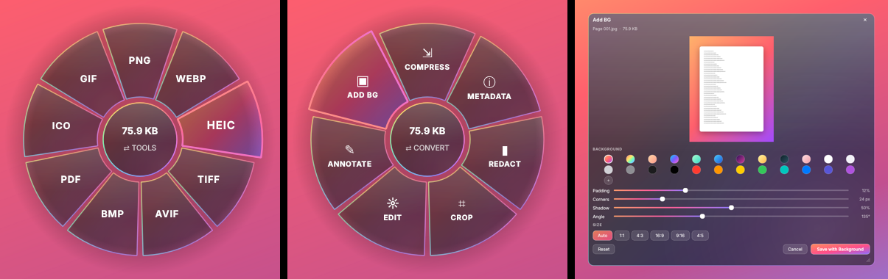

# DragShift

Convert and edit files on Windows with a liquid-glass radial menu. Start dragging any file, press **Shift**, and drop it on a slice.



## Download

Grab **DragShift.exe** from the [latest release](../../releases/latest) and double-click it. A rainbow ring icon appears in the system tray.

> Windows SmartScreen may warn because the app isn't code-signed. Click **More info → Run anyway**.

## How to use

1. Start dragging a file in Explorer or on the desktop.
2. Press **Shift**. The menu opens under your cursor.
3. Drop the file on a slice. The result is saved **next to the original**, and the original is never changed.
4. To switch between **Convert** and **Tools**, tap **Shift** again or hover over the centre.

Prefer clicking? Double-click the tray icon (or choose **Open a file…**) to pick a file. Dropping files onto `DragShift.exe` also works.

## What it does

| File | Convert to | Tools |
|---|---|---|
| Images (PNG, JPG, WEBP, HEIC, AVIF, TIFF, BMP, GIF, ICO) | Any of those + PDF. Several images → one combined PDF | Compress · Metadata (view / strip GPS + EXIF) · Redact · Crop · Edit · Annotate · Add BG |
| PDF | JPG, PNG (one per page), DOCX, TXT | Compress · Metadata · Split · Rotate · Merge (drop several) |
| Word (.docx) | PDF (uses Microsoft Word if installed, built-in renderer otherwise), TXT | — |
| Text (.txt, .md, .csv…) | PDF, DOCX | — |

Tray menu options: **Enabled**, **Start with Windows**, **Open a file…**, **Quit**.

## Run from source

```bash
pip install -r requirements.txt
python -m dragshift
```

Tests: `python -m pytest -q`

## Build

Every push to `main` triggers GitHub Actions, which builds `DragShift.exe` on Windows, runs the tests and a self-test of the built exe, and then publishes it to the **latest** release. To build locally on Windows, copy the PyInstaller command from `.github/workflows/build.yml`.
